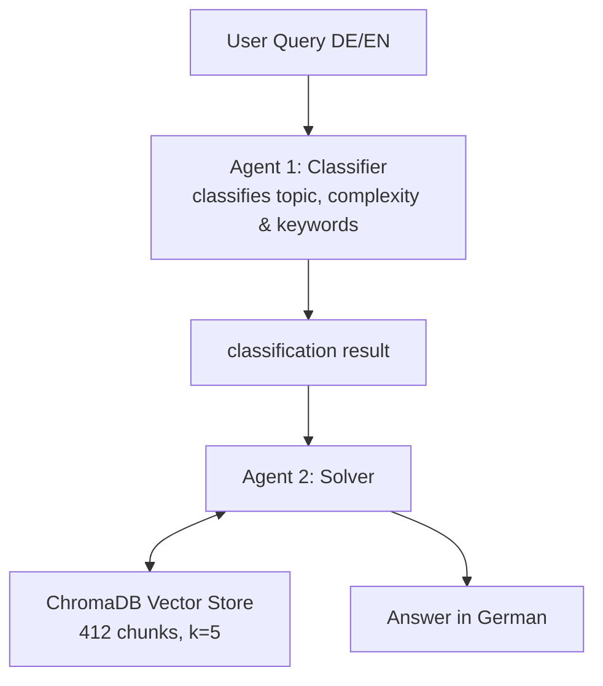

# 🤖 AI-Powered Study Assistant - # ai-study-assistant
### RAG + Multi-Agent System | LangChain · CrewAI · Groq · ChromaDB

## 📋 About This Project

This project demonstrates a production-ready **RAG pipeline (Retrieval-Augmented 
Generation)** combined with a **Multi-Agent System (Agent-to-Agent Communication)** –
two core technologies of modern enterprise AI systems.

Real university lecture slides (344 pages, 7 PDFs) serve as the knowledge base. 
Questions can be asked in German or English – the system automatically translates 
queries for semantic search since the source documents are in German and English.

## 🏗️ Architecture

## 🛠️ Tech Stack

| Component | Technology |
|---|---|
| LLM | Llama 4 (meta-llama/llama-4-scout-17b-16e-instruct) via Groq API |
| RAG Framework | LangChain 0.3.25 |
| Agent Framework | CrewAI 0.114.0 |
| Vector Database | ChromaDB 0.6.3 |
| Embeddings | HuggingFace – sentence-transformers/all-MiniLM-L6-v2 |
| Environment | Kaggle Notebook |

## ✨ Features

- **RAG Pipeline** – semantic search across 344 pages of lecture materials
- **Agent-to-Agent Communication** – Classifier passes results to Solver
- **Automatic Translation** – German queries are translated internally for 
  vector search (source PDFs are in English)
- **Interactive Widget UI** – chat interface directly inside the Kaggle Notebook
- **Source Citations** – every answer references the exact PDF page numbers

## 🚀 Setup

### 1. Prerequisites
- Kaggle Account
- Groq API Key (free at [console.groq.com](https://console.groq.com))

### 2. Configure Kaggle Secrets
In Kaggle under **Add-ons → Secrets**:
GROQ_API_KEY = gsk_...

### 3. Upload your own PDFs
Upload PDF documents via **Add Data → Upload** and adjust the 
`base_path` variable in Cell 3.

### 4. Run the Notebook
Execute all cells in order. After Cell 6, the interactive chat 
interface appears.

## 📁 Notebook Structure

| Cell | Description |
|---|---|
| Cell 0 | Project documentation (Markdown) |
| Cell 1 | Install all dependencies |
| Cell 2 | API setup, LLM & embedding configuration |
| Cell 3 | Auto-detect PDF files |
| Cell 4 | Build RAG pipeline & vector database |
| Cell 5 | RAG test (single query) |
| Cell 6 | Multi-Agent UI (CrewAI + ipywidgets) |

## 💡 Enterprise ITSM Relevance

This project was designed as a prototype for an **AI IT-Support Ticket Analyzer** –
directly applicable to real-world ITSM use cases:

- **RAG** replaces manual searches through ITIL knowledge bases
- **Agent 1** handles ticket classification (category, priority)
- **Agent 2** generates solution suggestions from the knowledge base
- The architecture is directly transferable to enterprise systems such as 
  **BMC Remedy/Helix** or **OpenShift** container deployments

## 📄 License

MIT License – feel free to use and adapt.

