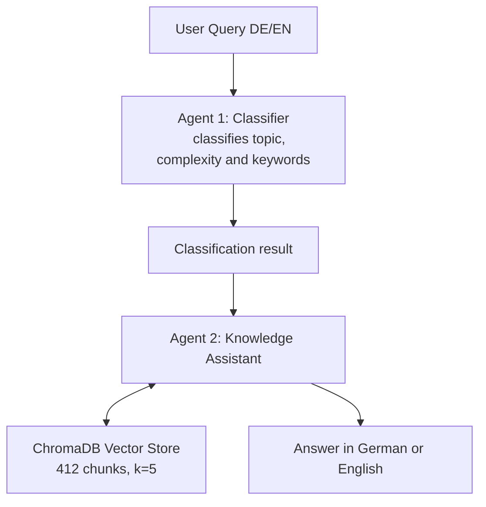

# AI-Powered Study Assistant

A prototype RAG and multi-agent study assistant that answers questions about
university lecture materials and returns page-level source citations.


## About This Project

This project is a prototype RAG and multi-agent system that answers questions
about university lecture materials and returns page-level source citations.

Real university lecture slides (344 pages, 7 PDFs) serve as the knowledge
base. Questions can be asked in German or English. German queries are
translated internally for semantic search, while answers are returned in the
language of the original question.

## Architecture



## Tech Stack

| Component | Technology |
|---|---|
| LLM | `openai/gpt-oss-20b` via Groq API |
| RAG framework | LangChain 0.3.25 |
| Agent framework | CrewAI 0.114.0 |
| Vector database | ChromaDB 0.6.3 |
| Embeddings | HuggingFace `sentence-transformers/all-MiniLM-L6-v2` |
| Environment | Kaggle Notebook |

## Features

- **RAG pipeline** — semantic search across 344 pages of lecture materials
- **Agent-to-agent workflow** — the classifier passes the query to the knowledge assistant
- **Automatic translation** — German queries are translated internally for vector search
- **Interactive widget UI** — chat interface directly inside the Kaggle Notebook
- **Source citations** — answers reference the relevant PDF pages

## Setup

### Prerequisites

- Kaggle account
- Groq API key

### Configure Kaggle Secrets

In Kaggle, go to **Add-ons → Secrets** and add:

```text
GROQ_API_KEY = gsk_...
```

Enable notebook access for the secret. Never hardcode API keys in the notebook.

### Upload your own PDFs

Upload your lecture PDFs through **Add Data → Upload** and adjust the
`base_path` variable in Cell 3.

## Usage

Run the notebook cells in order. The final cell starts an interactive chat
interface where you can ask questions in German or English.

Example question:

```text
Was ist ein Large Language Model?
```

The system retrieves relevant passages from the lecture PDFs, generates an
answer and returns the corresponding page-level sources.

## Notes and limitations

- This project is a prototype, not a production-ready application.
- The lecture PDFs are not included in this repository.
- The assistant answers from the uploaded lecture material; it does not have
  internet access.
- The model and retrieval settings can be changed in the notebook
  configuration.

## License

This project is released under the MIT License.
